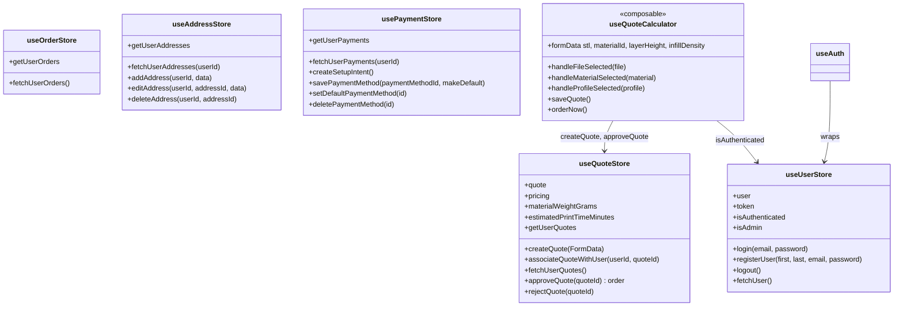
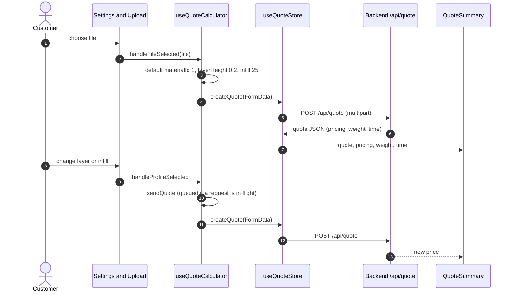
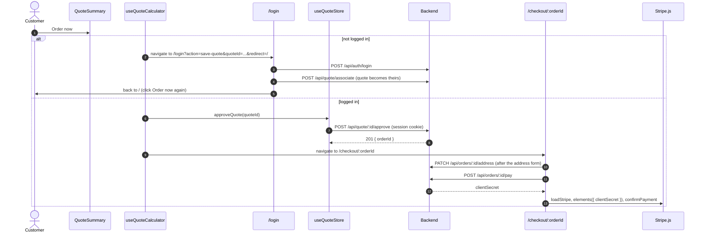

# PrintFlow 3D: Frontend Documentation

Nuxt 4 (Vue 3) storefront for an instant 3D-print quote service. Customers upload an STL, choose material and print settings, see a price, save or order the quote, then pay for the order with Stripe. Logged-in customers also manage their addresses and saved cards.

Backend reference: [../../3d-print-shop-api/docs/api.md](../../3d-print-shop-api/docs/api.md)

## Stack

| Concern | Technology |
|---|---|
| Framework | Nuxt 4, Vue 3, Vue Router (file-based pages) |
| State | Pinia (`@pinia/nuxt`) |
| HTTP | `$fetch` through `useRuntimeConfig().public.API_BASE_URL` |
| UI | Bootstrap 5.3 (CDN, with SRI), custom CSS in `app/assets/css/main.css` (which also loads Bootstrap Icons) |
| 3D preview | Three.js (`LiveRender.vue`) |
| Payments | `@stripe/stripe-js`: `confirmPayment` on checkout, `confirmSetup` in the card modal |

## Project layout

```
app/
  app.vue                 # <NuxtLayout><NuxtPage/>
  layouts/landing.vue     # Navbar, main slot, lazy Footer
  pages/                  # routes (see table below)
  components/             # Settings, Upload, LiveRender, QuoteSummary, AddressForm, Modal
    ui/                   # Navbar, Footer, Container, Input (base widgets)
    profile/              # Address, AddressModal, PaymentMethod, PaymentModal, ProfileHeader, Table
  composables/            # useQuoteCalculator, useAuth, useFileUpload, useFormValidation, useDeliveryEstimate
  stores/                 # Pinia: users, quotes, orders, addresses, payments
  middleware/             # auth (route guard)
  plugins/auth.ts         # asks the API who the session belongs to, in the browser only
  types/                  # Quote, PrintConfig, User, Address, Payment, Material
nuxt.config.ts            # runtime config, route rules, head/SEO
```

## Configuration

| Variable | Default | Purpose |
|---|---|---|
| `API_BASE_URL` (env) → `runtimeConfig.public.API_BASE_URL` | `http://localhost:4000/api` | Backend base URL. The browser calls this directly, so it must be reachable from the user's machine |
| `NUXT_PUBLIC_STRIPE_KEY` (env) → `STRIPE_PUBLIC_KEY` | a test publishable key in `nuxt.config.ts` | Stripe.js key. Must belong to the same Stripe account and mode as the API's secret key |

Docker: `docker-compose.yml` sets `API_BASE_URL=http://localhost:4000/api` for the `ui` service.

## Pages and rendering

Rendering modes come from `routeRules` in `nuxt.config.ts`.

| Route | File | Layout | Access | Rendering |
|---|---|---|---|---|
| `/` | `pages/index.vue` | landing | public | prerendered, SWR 1 hour |
| `/login` | `pages/login.vue` | landing | public | SSR |
| `/verify-email?token=` | `pages/verify-email.vue` | none | public | client only |
| `/profile` | `pages/profile.vue` | landing | `auth` middleware | client only |
| `/checkout/:orderId` | `pages/checkout/[orderId].vue` | landing | `auth` middleware | client only |
| `/item-list`, `/item-list/:id` | `pages/item-list/` | | public | prerendered |
| `/materials`, `/services`, `/marketplace` | placeholders, no content yet | landing | public | prerendered |
| `/prints` | placeholder, no content yet | | public | client only |
| `/coming-soon` | `pages/coming-soon.vue` | landing | public | prerendered |
| `/privacy`, `/terms`, `/enterprise`, `/api-documentation` | placeholder pages with a heading and a note that the text is being prepared | landing | public | prerendered |

Unknown routes produce a 404 page.

### Home page (quote builder)

`pages/index.vue` composes:

- `Upload`: drag-and-drop or file input. Accepts `.stl` only, up to 50 MB; other files show "Please upload a valid file (.stl)" and are not sent. Emits `file-selected`.
- `Settings`: material (PLA, ABS, PETG Clear cards, which map to material IDs 1, 4 and 5), layer height (0.1, 0.2, 0.3 mm), infill (15, 25, 50, 100 %), colour. Emits `profile-selected` and `material-selected`. The defaults shown (0.2 mm, 25 %, PLA) are the values the quote uses.
- `LiveRender`: Three.js preview of the uploaded file.
- `QuoteSummary` (lazy, hydrated when visible): price, weight, print time, delivery estimate (`useDeliveryEstimate`), with Save and Order buttons.

## State and data access

### Pinia stores



The stores call the API with `$fetch` and `API_BASE_URL` and send `credentials: "include"`, so the browser attaches the HttpOnly session cookie. The UI never reads or stores the token. `approveQuote` returns the created order (or `null` on failure); the other actions return nothing and set the store's `error` field on failure.

### Authentication

- The API sets the session cookie (`auth_token`) on login and register. It is `HttpOnly`, so page scripts cannot read it.
- `login` and `registerUser` call the API and then `fetchUser()`. `logout()` calls `POST /api/auth/logout`, which clears the cookie, then clears the store.
- `plugins/auth.ts` runs in the browser on app start and calls `fetchUser()`. `fetchUser()` asks `GET /api/auth/profile`: a 401 means logged out. The plugin does not run during server rendering.
- `middleware/auth.ts` redirects anonymous visitors to `/login?redirect=<page>`.

### Settings to API mapping

`Settings.vue` emits `{ layerHeight: "0.2mm", infillDensity: "25" }` and `{ id, material }` for materials. `useQuoteCalculator` converts these to `layerHeight` (number) and `infillDensity` (number), defaults to material 1, 0.2 mm and 25 %, and sends the STL as multipart with `materialId`, `layerHeight` and `infillDensity`. The API stores the matching `print_configs` row on the quote.

Material IDs must match the `materials` table: 1 PLA White, 4 ABS Black, 5 PETG Clear.

## Flows

### Quote creation

Every change to the file, material, layer height or infill triggers one request. A change made while a request is running is queued and sent after it finishes, so the last change always wins.



### Order now (guest and customer)



A guest is sent back to the home page after login, so they click **Order now** a second time. The quote is already attached to their account at that point.

### Profile page

- **Quotes History (7 days max):** Accept calls `quoteStore.approveQuote(id)`, which creates the order and refreshes both lists. Decline calls `rejectQuote` (pending quotes only).
- **Order History:** Pay navigates to `/checkout/:id`. Cancel calls `orderStore.cancelOrder`, which cancels an unpaid order. If the API refuses (for example a paid order), the page shows the message in an alert.
- **Addresses:** list with edit (opens `AddressModal`), add (`addressStore.addAddress`), delete (`addressStore.deleteAddress`) and **SET DEFAULT** on any address that is not the default (`addressStore.setPrimaryAddress`).
- **Payments:** the saved cards from `GET /api/payment-methods`, each with brand, last four digits, expiry and whether it is the default. **Make default** and **Remove** call the API. **add** opens `PaymentModal`, which collects the card with Stripe (`confirmSetup`) and then saves it through the API.

## Components

| Component | Purpose |
|---|---|
| `ui/Navbar.vue` | Top navigation, login state, links to `/services` and `/materials` |
| `ui/Footer.vue` | Footer links (all of them now have a page) |
| `Upload.vue` | File selection (STL only) and drag and drop, with the validation message from `useFileUpload` |
| `Settings.vue` | Material, layer height, infill and colour controls |
| `LiveRender.vue` | Three.js viewer for the uploaded STL |
| `QuoteSummary.vue` | Price breakdown and the Save and Order buttons |
| `AddressForm.vue`, `profile/AddressModal.vue` | Address fields (no validation composable yet; `useFormValidation` is only used by the login page) |
| `profile/PaymentMethod.vue` | Saved-card list with Make default and Remove |
| `profile/PaymentModal.vue` | Stripe card collection (`confirmSetup`) and save |
| `Modal.vue`, `ui/Input.vue`, `ui/Container.vue` | Shared widgets |

## Recent changes

| Area | Change | Where |
|---|---|---|
| Session | The UI no longer reads or sends the token. Requests send the HttpOnly cookie (`credentials: "include"`). Login, register and logout go through the API; the plugin checks the session with `GET /api/auth/profile` | `stores/users.ts`, `stores/*.ts`, `plugins/auth.ts`, `pages/checkout/[orderId].vue` |
| Logout | Logout called a relative URL, which reached the UI server instead of the API. It now calls the API | `stores/users.ts` |
| Orders | Cancel on the profile page cancels an unpaid order and shows the API's message when it is refused | `stores/orders.ts` `cancelOrder`, `pages/profile.vue` |
| Addresses | Any address that is not the default has a SET DEFAULT button | `components/profile/Address.vue`, `stores/addresses.ts` `setPrimaryAddress` |
| Checkout | Returning from a 3-D Secure redirect shows the success view. The return URL is the checkout page | `pages/checkout/[orderId].vue` |
| Dev server | The home page cache applies in production only, so the development server no longer serves stale HTML | `nuxt.config.ts` |
| Cleanup | Unused `composables/useApi.ts` and `middleware/verify-email.ts` removed | |

## Known issues

1. **Placeholder content.** `/materials`, `/services`, `/marketplace` and `/prints` have no content, and the four footer pages say the text is being prepared. The content is for the content owner to write.
2. **Paid orders cannot be cancelled from the UI.** The API refuses (409) and the page shows the message. Refunds are not built.
3. **The guest login flow needs a second click.** After logging in from **Order now**, the user returns to the home page and must click **Order now** again. The quote is already attached to their account by then.
4. **Development ports are published on localhost only.** Docker publishes the UI, API and database on `127.0.0.1`. The dev server still listens on all interfaces inside the container, so reach it through the published port only.

## Running

From the repository root:

```bash
docker compose up --build      # UI on http://localhost:3000
```

Without Docker:

```bash
pnpm install
pnpm dev                       # http://localhost:3000, expects the API on :4000
pnpm build                     # production build
```

The `postinstall` script runs `nuxt prepare`. `pnpm-lock.yaml` is the lockfile in use (`package-lock.json` is older).
